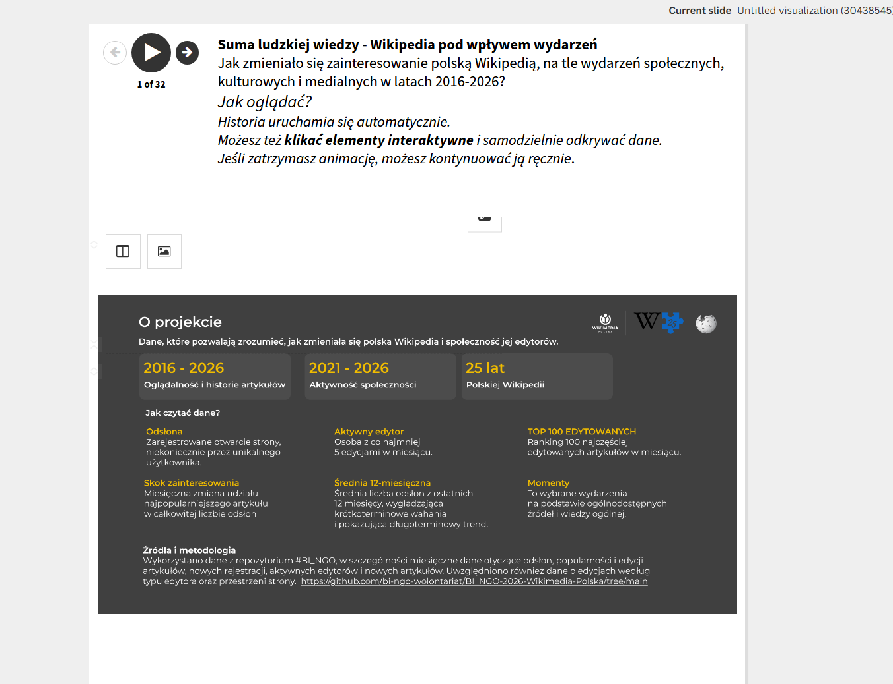
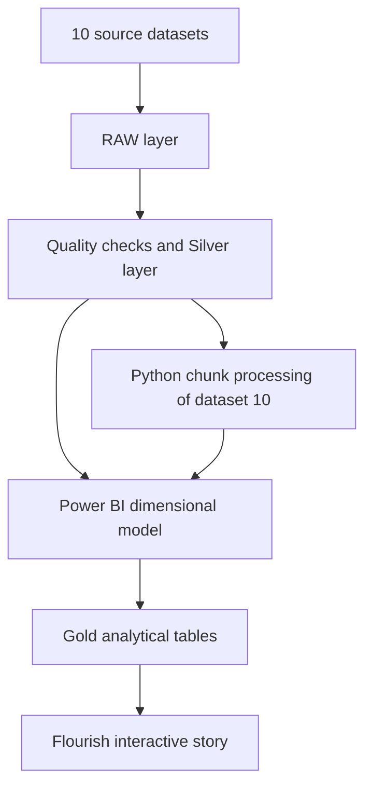
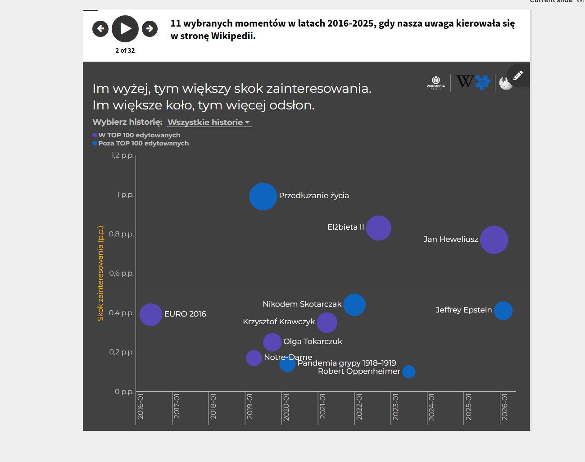
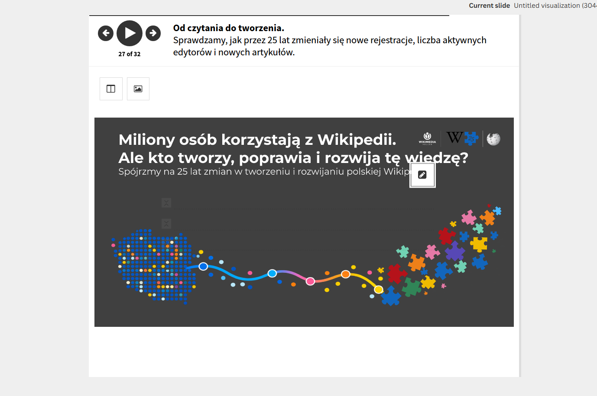
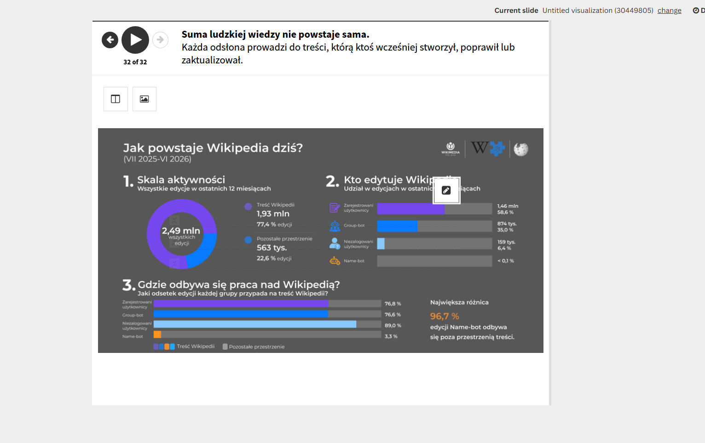

# The Sum of Human Knowledge

## How events shaped interest in Polish Wikipedia (2016–2026)

[View the interactive Flourish story](https://public.flourish.studio/story/3829783/)

This portfolio project explores how social, cultural and media events coincided with changes in interest in Polish Wikipedia — and then shifts the perspective from readers to the people and automated accounts that create, improve and maintain the encyclopedia.

The final output is a 32-slide interactive story built in Flourish. Behind it sits a multi-stage analytical workflow combining data profiling, Power Query, a dimensional Power BI model, Python/pandas processing of large compressed files, validation and curated event research.



## Analytical scope

- article views and article histories: **2016–2026**;
- community activity: **2021–2026**;
- a broader perspective on **25 years of Polish Wikipedia**;
- **11 curated moments** linking changes in readership to real-world context;
- current editing activity split by editor type and namespace.

The project asks two connected questions:

1. How did interest in Polish Wikipedia change around important events?
2. Who creates and maintains the knowledge that millions of people read?

## Data workflow



### 1. Data discovery and quality control

I profiled source files 1–9 before modelling them. The checks covered:

- row and column structure;
- candidate and primary keys;
- missing values and duplicates;
- data types and consistency;
- data-quality errors that could affect joins or measures.

Dataset 10 was separated from the smaller files because its size required a different processing strategy in Python.

### 2. RAW–Silver–Gold architecture

- **RAW:** preserved source data;
- **Silver:** cleaned, validated and standardised tables;
- **Gold:** analysis-ready fact and dimension tables plus exports prepared for Flourish.

In Power BI I created a star-schema-style model, including:

- `fact_monthly_activity`, built from source files 2, 3 and 4;
- `dim_article`;
- `dim_map`;
- an `Is Polish only` attribute sourced from file 6;
- top-viewed and top-edited article logic;
- explicit dimension-to-fact relationships.

### 3. Large-file processing in Python

The large monthly page-view files were processed with pandas in chunks rather than loaded into memory at once. The automated workflow:

- read compressed TSV.GZ files;
- validated file structure and column types;
- checked missing values, duplicates and `page_id` integrity;
- calculated monthly record count, total views, average views and minimum/maximum views;
- processed **126 monthly files**;
- created a monthly control table and exported it to CSV;
- preserved `page_id` during transformations;
- selected the **top 1,000 page IDs by views for each month**;
- generated monthly ranks, combined results and exported analysis-ready tables to Power BI.

### 4. Event-based analysis and storytelling

Changes in the data were examined against documented social, cultural and media events. The final 11 moments were intentionally curated: they are not presented as the 11 largest statistical anomalies. They were selected because they offered meaningful context and represented different kinds of events.

Persistent high-volume pages that did not represent a clear event-driven change were not treated as moments. The visual story distinguishes articles appearing in the monthly top 100 edited pages from those outside that group.



### 5. From reading to creating

The second part of the story moves from readership to community activity: registrations, active editors, new articles, editor types and editing spaces.





## Tools

| Stage | Tools |
|---|---|
| Data inspection and transformation | Excel, Power Query |
| Large-file processing and validation | Python, pandas |
| Data modelling and measures | Power BI, DAX |
| Interactive visualisation and narrative | Flourish |
| Intermediate exchange formats | CSV, Excel |

## What this project demonstrates

- choosing processing methods according to dataset size;
- building and validating a dimensional analytical model;
- automating repetitive monthly processing;
- keeping stable identifiers through transformations;
- connecting quantitative signals with researched context;
- translating a complex workflow into an accessible interactive narrative;
- moving reliably between CSV, Excel, Python, Power BI and Flourish.

## Interpretation limits

- The 11 moments are a curated analytical sample, not an automated anomaly ranking.
- Page views show attention, not readers' opinions or motivations.
- The top-1,000 monthly extraction reduces processing cost but excludes the long tail from detailed article-level analysis.
- A temporal association between an event and a spike does not by itself prove causality.
- Twelve-month rolling averages clarify long-term trends but smooth short-term changes.

## Data source

The analysis uses the dataset published for the BI NGO 2026 Wikipedia project:

[BI NGO 2026 — Wikimedia Polska dataset repository](https://github.com/bi-ngo-wolontariat/BI_NGO-2026-Wikimedia-Polska/tree/main)

Raw source files are not duplicated in this repository. Refer to the source repository for availability, definitions and licensing information.

## Repository contents

```text
.
├── README.md
├── assets/
│   ├── community-story.png
│   ├── editor-activity-dashboard.png
│   ├── event-spikes.png
│   └── project-overview.png
└── docs/
    └── METHODOLOGY.md
```

The published version documents the analytical process and presents selected outputs. Original processing scripts should be added only from the working project files; they have not been reconstructed from the description.
